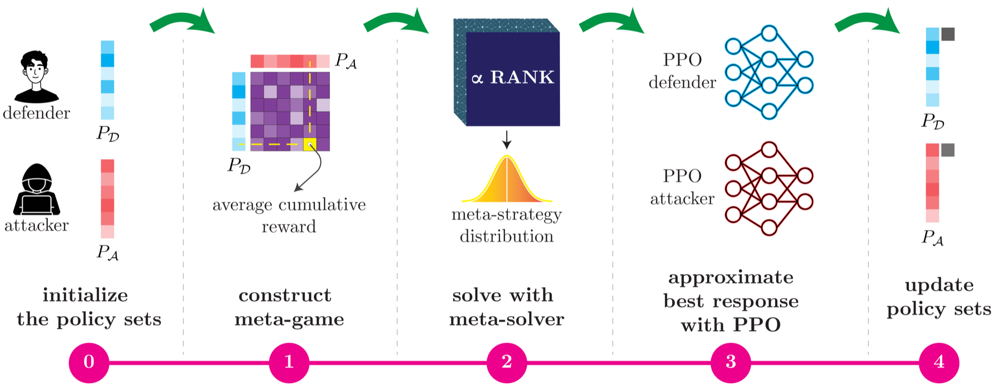

# PuReX: Game-Theoretic Pull Request Assignment with Deep RL

[](https://doi.org/10.1007/978-3-032-08064-6_10)
[](CITATION.cff)
[](LICENSE)
[](pyproject.toml)
[](pyproject.toml)

PuReX is a research implementation of the two-player pull-request assignment game in **“PuRe Defender: A Game-Theoretic Pull Request Assignment with Deep RL.”** It models a defender assigning requests to maintainers and a stealthy attacker submitting malicious requests, then trains policy populations with Proximal Policy Optimization (PPO) oracles in a Policy-Space Response Oracle (PSRO) loop.

Read the paper: [*PuRe Defender: A Game-Theoretic Pull Request Assignment with Deep RL*](https://doi.org/10.1007/978-3-032-08064-6_10).

## PSRO workflow

[](https://doi.org/10.1007/978-3-032-08064-6_10)

*PSRO training loop from the paper, Figure 3. Select the image to open the paper.*

The simulator instantiates the paper's small Pandapower and large NumPy case-study parameters. The paper does not publish its source data or several implementation details; consequently, this repository makes those choices configurable and documents them as assumptions. It does not claim bit-for-bit reproduction of the reported results.

## Install

Python 3.10 through 3.12 is supported. From a clone of this repository:

```bash
python -m venv .venv
source .venv/bin/activate
python -m pip install --upgrade pip
python -m pip install -e .
purex --help
```

## Run an experiment

Train both policy populations in the small case study. Seeds, environment, optimizer settings, meta-game payoff estimates, and trained checkpoints are saved under the output directory:

```bash
purex train \
  --config configs/pandapower-small.json \
  --seed 2025 \
  --iterations 5 \
  --oracle-episodes 16 \
  --payoff-episodes 8 \
  --output outputs/pandapower-small-seed-2025
```

Evaluate the paper's greedy baselines over 1,000 independent episodes:

```bash
purex evaluate \
  --config configs/numpy-large.json \
  --defender-baseline greedy \
  --attacker-baseline greedy \
  --episodes 1000 \
  --seed 2025 \
  --output outputs/numpy-large-greedy.json
```

Evaluate trained checkpoints by passing `--defender` and `--attacker` paths. A run manifest records all training settings and sampled meta-game payoffs. PPO and PSRO run sizes can be increased through CLI options; full paper-scale budgets require substantial compute, as described in the paper.

## Model

The finite-horizon game has a defender and attacker. The defender observes maintainer loads and the public priority of each unresolved request, but not whether it is malicious. The attacker observes request types and the defender's assignment outcome. Maintainers have senior, intermediate, or junior expertise. Detection probabilities, resolution times, rewards, time horizon, maintainer counts, and per-priority malicious-submission limits come from the paper's Table 1. Matrix rows are mapped junior through senior because detection improves and resolution time falls across the reported rows; [the model notes](docs/model.md#expertise-row-mapping) explain this interpretation.

For tractable policy learning, each set-valued decision is factorized into categorical choices over urgent, normal, low, and skip/stop. Defenders make one choice for each available maintainer; attackers make a sequential batch of choices up to the stealth capacity. A selected request is the oldest request at that priority. This action representation is an implementation assumption; see [the model and assumptions](docs/model.md).

## Reproducibility and citations

See [reproducibility notes](docs/reproducibility.md) for reported values, defaults, seed handling, output files, and limitations. Cite the framework's defining paper:

```bibtex
@inproceedings{koushyar2025puredefender,
  author    = {Mokhtari Koushyar, Javad and Guirguis, Mina and Atia, George K.},
  title     = {PuRe Defender: A Game-Theoretic Pull Request Assignment with Deep RL},
  booktitle = {Game Theory and AI for Security},
  series    = {Lecture Notes in Computer Science},
  volume    = {16223},
  pages     = {193--212},
  publisher = {Springer},
  year      = {2025},
  doi       = {10.1007/978-3-032-08064-6_10}
}
```

Use the machine-readable [CITATION.cff](CITATION.cff) metadata for software citation. A versioned software archive DOI should be added there when one is minted.

For the software itself before an archive DOI is available:

```bibtex
@software{purex2026,
  author  = {{PuReX contributors}},
  title   = {{PuReX}: Game-Theoretic Pull Request Assignment with Deep Reinforcement Learning},
  version = {0.1.0},
  year    = {2026},
  url     = {https://github.com/j0m0k0/PuReX}
}
```

## Project scope

PuReX implements the paper's pull-request assignment game, PPO policies, PSRO population training, and Random/Greedy baselines. It is a research simulator, not a GitHub bot, malware detector, or production review system.

